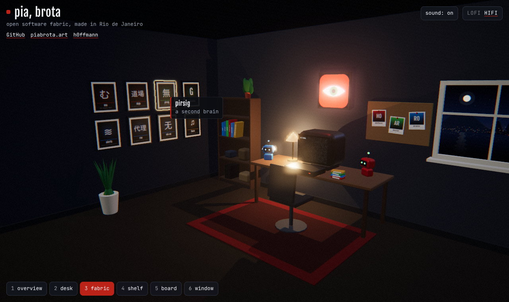
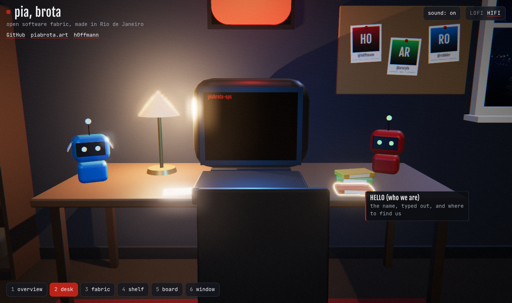
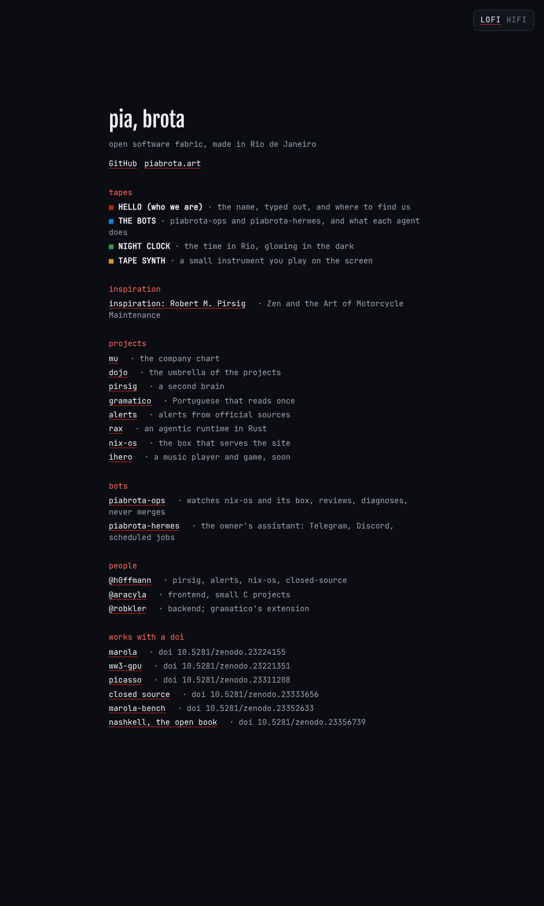

# room

A personal site that is a 3D room. Switch between camera shots, hover over things to see what
they are, put a tape into the VCR to play it on the TV, and listen to the room. Built with
[three.js](https://threejs.org) and [Vite](https://vite.dev), as static files.

The idea of a room like this comes from **Felix Rieseberg**, who made one as his own personal
site. This is a separate build, with its own assets, signature, sounds and interactions
([`CREDITS.md`](CREDITS.md)).

## What is in the room

This is piabrota's room. The left wall holds the fabric, one framed print per project, each a
link to its repository. The two bots of the org, piabrota-ops and piabrota-hermes, sit on the
desk; the board holds the people; the shelf holds the works with a DOI by Matheus Hoffmann:
marola ([10.5281/zenodo.23224155](https://doi.org/10.5281/zenodo.23224155)), ww3-gpu
([10.5281/zenodo.23221351](https://doi.org/10.5281/zenodo.23221351)), picasso
([10.5281/zenodo.23311208](https://doi.org/10.5281/zenodo.23311208)), closed source
([10.5281/zenodo.23333656](https://doi.org/10.5281/zenodo.23333656)), marola-bench
([10.5281/zenodo.23352633](https://doi.org/10.5281/zenodo.23352633)) and nashkell, the open book
([10.5281/zenodo.23356739](https://doi.org/10.5281/zenodo.23356739)). The window looks on Rio at
night, and the eye above the TV is the piabrota sign.

Move with the shot buttons, the keys 1 to 9, `←` `→`, or a swipe; `Esc` steps back. The camera
moves on quintic curves that keep their speed when you change your mind halfway, so no move
ever jerks. The picture goes through a post-processing chain (outline on hover, bloom, a film
grade) that lowers its own quality when the frame rate drops.

## Run it

With Nix:

```sh
nix develop      # or: direnv allow
just setup
just dev         # http://localhost:5173
```

On macOS without Nix: `brew install node just ffmpeg`, then the same `just` recipes.

`just check` runs the checks of [`AGENTS.md`](AGENTS.md) and a build; `just build` writes the
site to `dist/`, ready for any static host.

## Make it yours

Everything personal is in [`src/config.js`](src/config.js): the name and links, the camera
shots, the tapes, the hotspots and the sounds. Until there is a model and recordings, the room
is built from boxes and the sounds are synthesized, so it always runs.

1. **Model.** Block the room out in Blender at real scale, name the meshes (`screen`, `vcr`,
   `lamp`, `tape_<id>`, hotspots) and the cameras (`shot_desk`, ...), bake the lighting, and
   export `public/models/room.glb` (at most 10 MB).
2. **Sounds.** Record a room tone and a few clicks, then `just audio take.wav ambience`.
3. **Tapes.** Copy `src/tapes/hello.js`; a tape draws on the TV canvas and can be a CV, a
   slideshow, a game or an instrument.
4. **Signature.** Name, colours and type in `src/config.js` and `src/style.css`.

The LOFI/HIFI button in the corner switches between the 3D room (HIFI) and the same content as
plain text (LOFI): the name, the links and the tapes. The choice is remembered, and `?lofi` in the
address opens the text view (`?static` still works). Without WebGL, LOFI is the only view.

| Placeholder room, hover | A tape playing | LOFI |
|---|---|---|
|  |  |  |

## Licence

[MPL-2.0](LICENSE). The assets in `public/` are the owner's unless `CREDITS.md` says otherwise.
