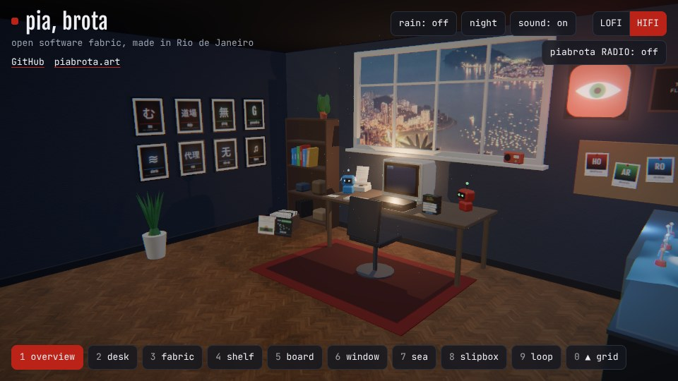
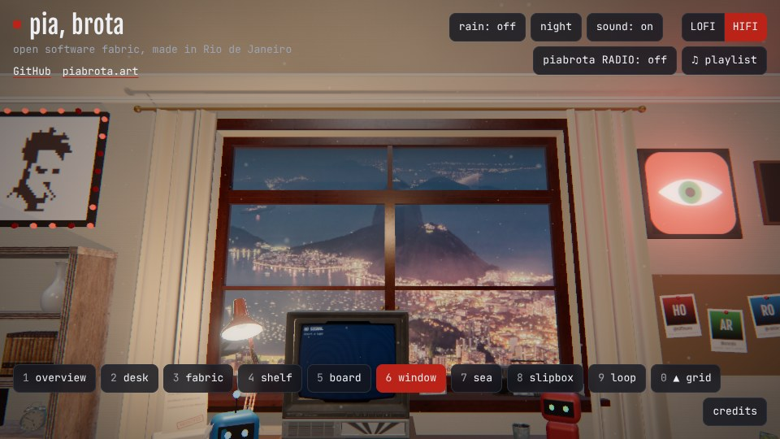
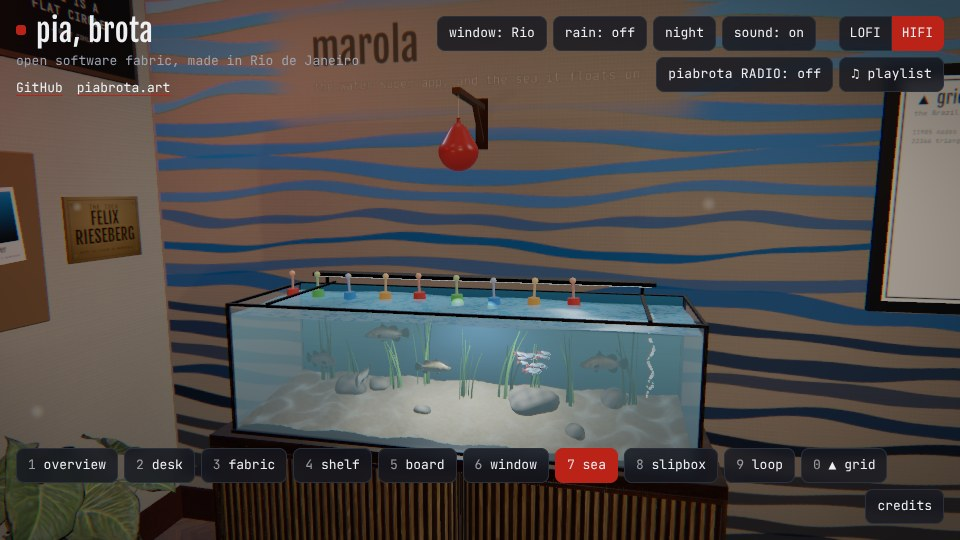
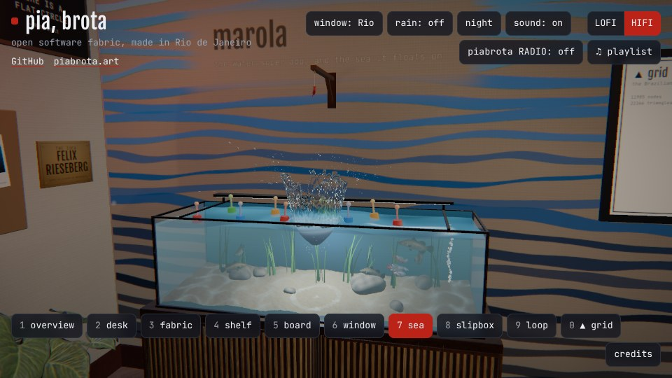

# room

English · [Português (Brasil)](README.pt-BR.md)

A personal site that is a 3D room. Switch between camera shots, hover over things to see what
they are, put a tape into the VCR to play it on the TV, and listen to the room. Built with
[three.js](https://threejs.org) and [Vite](https://vite.dev), as static files.

The idea of a room like this comes from **Felix Rieseberg** (`felixrieseberg` on GitHub), who
made one as his own personal site. His name and login are written as text, with no link
([`AGENTS.md`](AGENTS.md), invariant 2). This is a separate build, with its own assets, signature, sounds and interactions
([`CREDITS.md`](CREDITS.md)).


## Replay: how it was built

The room was built from prompts, in one Claude project, in about two hours of agent time
spread over a day. A coordinator (Claude Fable 5.1) read each prompt and started a thread for
it; each thread (Claude Opus 5.5, 1M context, in Claude Code) did the work and opened the pull
request. Only the owner's prompts are shown, with their typos fixed; the replies are left out. The
first two are in files, so you can read them whole:

- [`prompts/PROMPT_1.txt`](prompts/PROMPT_1.txt): understand the reference room, start a starter
- [`prompts/PROMPT_2.txt`](prompts/PROMPT_2.txt): the repository, its ten invariants ([`AGENTS.md`](AGENTS.md))

To set up the same Claude project for your fork, without the Claude Code CLI, follow
[`docs/CLAUDE_PROJECT.md`](docs/CLAUDE_PROJECT.md): its name, repositories, instructions and models.

Times are UTC. "Took" runs from the prompt to the pull request being ready for review.

| # | Prompt (UTC) | Result | Took |
|---|---|---|---|
| 1 | 4 Nov 21:20 | a starter scaffold, outside this repository | 7 min |
| 2 | 5 Nov 14:35 | [#1](https://github.com/piabrota/room/pull/1) starter, `AGENTS.md`, just and Nix | 7 min |
| 3 | 5 Nov 16:51 | [#2](https://github.com/piabrota/room/pull/2) the LOFI/HIFI toggle | 4 min |
| 4 | 5 Nov 19:17 | the deploy to room.piabrota.art, in [piabrota/nix-os#146](https://github.com/piabrota/nix-os/pull/146) (live 22:11) | 4 min |
| 5 | 5 Nov 22:28 | [#3](https://github.com/piabrota/room/pull/3) the piabrota tape and `just compose`; [#4](https://github.com/piabrota/room/pull/4) smooth moves, post-processing | 11 and 22 min |
| 6 | 5 Nov 22:51 | [#5](https://github.com/piabrota/room/pull/5) `just record`, the right wall and the ceiling | 17 min |
| 7 | 5 Nov 23:21 | [#6](https://github.com/piabrota/room/pull/6) the room in 360°, the window on Rio, piabrota RADIO | 50 min |
| 8 | 6 Nov 00:33 | [#7](https://github.com/piabrota/room/pull/7) the radio's own budget; [#12](https://github.com/piabrota/room/pull/12) 40 radio tracks in two stations and a listeners count, day and night, the rain button, the slipbox, the letter board, the favicon | 3 and 45 min |
| 9 | 6 Nov 00:50 | this README | |
| 10 | 6 Nov 01:24 | [#13](https://github.com/piabrota/room/pull/13) the project's settings, in [`docs/CLAUDE_PROJECT.md`](docs/CLAUDE_PROJECT.md) | 6 min |
| 11 | 6 Nov 01:40 | [#15](https://github.com/piabrota/room/pull/15) the wide window in the middle, a locked door, your feet when you look down, photographed wood, a beige computer, VHS tapes with retro labels, the CV, marola.dev and ouroboric-dev tapes, a fax, the Pirsig and pirsig cards, the closed-source file | 35 min |
| 12 | 6 Nov 03:38 | [#16](https://github.com/piabrota/room/pull/16) a survey, [`docs/SURVEY.md`](docs/SURVEY.md): other rooms, frameworks, animation, our own shaders, a faster `just record`, the ▲ grid view with WW3 on triangles, and why the day blows out to white | 42 min |
| 13 | 6 Nov 04:07 | [#16](https://github.com/piabrota/room/pull/16), second commit: the day no longer burns white (bloom by day and by night, AgX, the lamp dimmed by day), `just light`, a faster `just record` and `just stills`, CRT glass on the TV, dust in the window's light, and five Claude skills in `.claude/skills/` | 26 min |
| 14 | 5 Nov 23:23 | [#17](https://github.com/piabrota/room/pull/17) LOFI as a page to read: home, about, work, posts from Markdown, online, subscribe by RSS (built 6 Nov) | 15 min |
| 15 | 6 Nov 04:29 | [#18](https://github.com/piabrota/room/pull/18) ▲ grid, the tenth view on key 0: a chart on the wall that opens a map of the Brazilian coast on 22 366 triangles, with 24 h of GFS wind and the sea it raises; the TV's light follows the tape, rain on the glass, swaying leaves, Vite 6 | 52 min |
| 16 | 6 Nov 05:15 | [#19](https://github.com/piabrota/room/pull/19) ▲ grid: the sea's temperature from Copernicus Marine (OSTIA, read from its open zarr store) as a second layer, and particles that flow where the waves travel, in place of the wind's ticks | 30 min |
| 17 | 7 Nov 18:24 | [#20](https://github.com/piabrota/room/pull/20) the README's video, by night only, the four walls five seconds or more each, also as `docs/record/room.webp`; the same in h0ffmann's profile ([h0ffmann/h0ffmann#144](https://github.com/h0ffmann/h0ffmann/pull/144)) | 30 min |
| 18 | 7 Nov 18:53 | [#21](https://github.com/piabrota/room/pull/21) the night no longer burns white at the desk (the lamp at 0.7 by night, a softer bloom), and `scripts/blow_light.sh` (`just blow-light`), which fails a video when a frame burns; `just record` runs it. Both videos again in the profile ([h0ffmann/h0ffmann#145](https://github.com/h0ffmann/h0ffmann/pull/145)) | 45 min |
| 19 | 9 Nov 05:50 | [#23](https://github.com/piabrota/room/pull/23) ▲ grid fills the whole window: the signature and the switches step aside while the map is open, the panel folds to the title, the time and the legend (`+` for the rest), a ⛶ button for the whole screen, the sources in an ⓘ in the corner, and the coast fitted beside the panel | 30 min |
| 20 | 9 Nov 06:23 | [#24](https://github.com/piabrota/room/pull/24) a ♫ playlist button beside the radio's, and a mixtape on the sill beside the radio, both opening the owner's Spotify playlist; the playlist in LOFI's online list too | 30 min |
| 21 | 9 Nov 06:50 | [#25](https://github.com/piabrota/room/pull/25) invariants 1, 5 and 7 let in Spotify's Embed player; [#26](https://github.com/piabrota/room/pull/26) the mixtape and the ♫ button open the playlist in Spotify's player over the room, the 37 tracks and their artists credited in `CREDITS.md` and beside the player, and an "open in Spotify" that plays them all in any browser | 25 min |
| 22 | 9 Nov 11:18 | [#28](https://github.com/piabrota/room/pull/28) ▲ grid on its own name, grid.piabrota.art: there (or with `?grid`) the room opens straight on the map, and Esc or "back to the room" steps into the room, where the gate for the sound waits; served by [piabrota/nix-os#186](https://github.com/piabrota/nix-os/pull/186) | 40 min |
| 23 | 9 Nov 16:54 | [#29](https://github.com/piabrota/room/pull/29) ▲ grid views: a row of buttons in the map's panel (Brasil, Rio de Janeiro, Bahia, Salvador) that fits the map to each box of `config.grid.presets`, eased, or at once with reduced motion; a check for the boxes; `just record-grid` for their stills and clip | 15 min |
| 24 | 9 Nov 10:56 | [#27](https://github.com/piabrota/room/pull/27) a slate beside the people's board for tyler-durden-bot, the GitHub App that sums up a large pull request: its mark drawn in code (a bot's head split in two), its name, and hazard tape that says "work in progress"; it links to its pull request in piabrota/agents | 35 min |
| 25 | 9 Nov 19:43 | [#30](https://github.com/piabrota/room/pull/30) the room on a phone: a `lite` look for phones, tablets and weak machines (pixel ratio 1.25 at most, 30 frames a second, no ambient occlusion, smaller shadow maps), the grid's sea and the day photo loaded only when needed (3.1 MB → 1.8 MB before the room shows), `just mobile` to measure, and two skills, `room-mobile` and `room-phone-test`; the door's code lock, its four digits counted in the room; a screen guard (black on PrintScreen and while the window is away, the lock's words not selectable); Nash, a black cat who wanders from the rug to the shelf; tyler-durden-bot's big board on the front wall, the owner's pixel portrait in a ring of red bulbs that blink at night (with #27) | 55 min |
| 26 | 9 Nov 21:54 | [#31](https://github.com/piabrota/room/pull/31) tyler-durden-bot's board square, above the shelf of the works with a DOI, the owner's portrait as it is; the loop shot shows the door; the door asks for an email before its lock, kept on the room's own server (`POST /live/door`) | 60 min |
| 27 | 9 Nov 22:48 | [#32](https://github.com/piabrota/room/pull/32) Nash on a desktop: he reads the room once (its triangles cut into floor cells and voxels), walks rounded A* paths around the desk's legs, the chair and the plant, eased in and out, turns before he sets off, sits where his body fits (no longer inside the radio or the keyboard) and leaps on parabolas tried against the room; phones keep the cheap life. His meow is a real cat now, a public-domain recording | 40 min |
| 28 | 9 Nov 23:13 | [#33](https://github.com/piabrota/room/pull/33) a "lyrics" toggle in the playlist's player that says where the lyrics are (Spotify's own app) and shows none, since the room has no licence for them; the playlist's tracks and artists read again from Spotify's player, 37 tracks and 42 artists, in `CREDITS.md` and beside the player | 25 min |
| 29 | 10 Nov 00:03 | [#34](https://github.com/piabrota/room/pull/34) the room as an old apartment, at real sizes: plaster walls, a cornice and a ceiling rose, tall skirting, a wooden window of two leaves in a deep reveal, curtains, parquet and a drawn rug; 24 pieces of furniture and props from Poly Haven (CC0) through `just models`, each with a lighter file for the phone; VHS cassettes in card sleeves, in two piles, and a video recorder they fly into, at their real sizes; the night lit by its lamps; a credits button, its card and a brass plate that name Felix Rieseberg; `just peek` to look at a change and count its draw calls | 3 h 55 min |
| 30 | 10 Nov 12:48 | [#36](https://github.com/piabrota/room/pull/36) the room opens faster: nothing waits for the furniture any more (it comes after the first frame, four files at a time), the files are sized to the device (the small ones on a phone, a small screen or a slow line), the grid chart's mesh waits too, so a laptop downloads 2.3 MB before the room shows instead of 9.5 and a phone 0.8 instead of 2.6; the marola wall painted with blue stripes from corner to corner; the floating water is an aquarium, with sand, stones, plants, bubbles, a school of small fish and Microsoft's Barramundi (CC0) swimming; on a phone, the buttons in two rows that scroll under the thumb and hints for a finger; three skills, `room-threejs-perf`, `room-assets` and `room-load` | 2 h 25 min |
| 31 | 10 Nov 20:07 | [#37](https://github.com/piabrota/room/pull/37) the playlist credited to Leonardo AL aracyla, its owner now, beside the player and in `CREDITS.md`; its tracks and artists read again from Spotify's player, 60 tracks and 63 artists; what plays now beside the player (title, artists, time, bars that dance) and the mixtape's reels turning, read from the messages Spotify's player posts, the covers left in Spotify's player; a window button that puts Copacabana live (Homes in Rio's webcam at Posto 6, YouTube, muted) behind the glass, the frame in front of it, with invariant 1 widened for it; "how I read", ten ebooks on the bookcase under the works with a DOI, each a spine in its cover's colours and a link to its Leanpub page | 1 h 50 min |
| 32 | 11 Nov 05:24 | [#40](https://github.com/piabrota/room/pull/40) a water balloon hangs over the aquarium: a click bursts it and its 1.4 litres fall into the tank, simulated in metres and seconds (the rubber that snaps back, the fall, the crater, a crown thrown up and left to gravity, drops with the air's drag, Worthington's jet, bubbles, Cauchy and Poisson's rings that come back from the glass, the tank's slow swing, the buoys that ride them, light rings on the sand, the fish frightened), its water drawn as a lens that bends a picture of the room; made by a builder and a separate critic that takes its own screenshots and scores them, the way of a video by AI Search, in three rounds that scored 6, 5.5 and 6 of 10, so it did not pass at 8; [The water balloon](#the-water-balloon) has the physics, and what is computed and what is fitted; `just record-splash`, and `just peek --click` | 4 h 25 min |

**1.** [`PROMPT_1.txt`](prompts/PROMPT_1.txt)

```text
user> '[the address of Felix Rieseberg's room] Check the website of this Anthropic Engineer. It is
not something professional, is his personal website. I just want to understand structure,
frameworks, and try to build one on my own, with my assets, my signature, my sounds, my
interaction'
```

**2.** [`PROMPT_2.txt`](prompts/PROMPT_2.txt)

```text
user> 'I have added piabrota/room. Create the first PR, with AGENTS.md 10 invariants, derive
the invariants based on the first prompts (including threads). Idea must be credited to
original creator, but don't link any external repo or issue. Consider this will be tested with
macOS or Nix with just and Claude Code assistance'
```

**3.**

```text
user> 'merged, now add a LOFI HIFI button for switching between 3D rendered view vs plain text'
```

**4.**

```text
user> 'please create a new PR in piabrota/nix-os to deploy room site under piabrota.art/room
(KVM 4) or room.piabrota.art (KVM 4) as well'
```

**5.**

```text
user> 'Fix the room, the navigation between views of the room is not smooth, room design should
contain piabrota github org bot repos, names, art, inspiration. also improve tech stack to match
[the address of Felix Rieseberg's room]
https://freesound.org/people/magedu/sounds/267832/
https://freesound.org/people/klankbeeld/sounds/219877/
https://freesound.org/people/klankbeeld/sounds/174242/
https://freesound.org/people/YleArkisto/sounds/350358/

Do a sound composition to have a track to talk about piabrota, its members, my personal
projects, link to repositories. The site is very poor at the moment, it needs a lot of refinement'
```

**6.**

```text
user> 'continue improving the site, every site must have at least 3 screenshots of the
ambient, and a screen record of 15s, doing navigation and clicking on things'
```

**7.**

```text
user> 'keep improving, more originality, bring marola-dev work, ouroboric-dev work, h0ffmann
all IP'
user> 'the room must have 360 experience, other walls should reflect marola-dev, ouroboric-dev'
```

**8.**

```text
user> 'create a live listeners button, and increase the number of songs to 33 at least, if
possible another set of specific Brazilian lofi, also do the switch between lofi and hifi
views, they look opposite in the site (hifi is the 3D room). add a favicon, the same as the company
logo, check on piabrota/.github. remove the noise from the website completely (the rain sound
must be toggle, on and off). The site also lacks day and night modes (with different lights).
Records must be named slipbox and first item should be wikipedia link for pirsig, and pirsig
github repository side by side'
user> 'also add a board, on the wall with Time is a flat circle with Rust Cohle, near the
piabrota logo above the computer'
```

**9.**

```text
user> 'refactor README.md to be more in replay style, it must have direct links for
PROMPT_1.txt and PROMPT_2.txt so people can see how it was built, using which model, when, how
much it took. Thread response is not important user> 'original prompt' is enough'
user> 'for example remove DOI numbers, it's just noise, this repo should be easy to fork'
user> 'and modular, so people can use their own slang, lists, music'
user> 'Felix Rieseberg GitHub user must be cited on README.md, also create a README.pt-BR.md
version'
user> 'please solve my personal typos in README.md'
```

**10.**

```text
user> 'in a new PR dump your entire Claude Project settings, in the same way is done in other
repos like piabrota/nix-os, so people can reproduce same environment with another Claude
Project, without need of Claude Code CLI'
```

**11.**

```text
user> 'now do a big change on the scene, window should be way bigger and wider, and be central
on top of the center wall. Also textures still dont feel realistic, like real wood, real
computer, real VHS. The must be a door in the scene locked for now. the feet of the persona
must be visible when they are at the center looking down (a bit of self perspective.). Also
create a VHS for CV with my track record from h0ffmann/h0ffmann of my personal experiences. VHS
tapes must be more realistic wider (with retro fonts like marola.dev, ouroboric-dev, cv /
h0ffmann), also add a fax with my email mhoffmann [at] gmail.com and a linkedin button. Also
improve slipbox, the Robert Pirsig card must looklike realistic with reference to ZAMM, and the
other card must have a github pill for pirsig repository, technical implementation of pirsig
brain. it must also contain a file under the desk callled closed source with confidencial
letter pointing to h0ffmann/closed-source website and paper'
```

**12.**

```text
user> 'Do a survey now based on the new code and unique techniques to improve design and realism
of existing room code. This must include:
1. Check other FOSS room websites, to grab ideas with credits
2. Check other frameworks.
3. Check other animation tools to make the site more appealing
4. Create our own shaders, textures, etc.
5. How to make the development loop faster (the final recording, the video, takes about 25 min
in software)
6. How this could align to add a new view in the website, the 10th one, called ▲ grid, with a
triangular grid for the Brazilian coast, the idea of triangle grids proposed by Dr. Aaron from
NOAA, wave model physicist, and how to use WW3, with this preset grid with GFS, to be able to
play it back on the MapLibre map, in the triangular grid, with small resolution/forecast
horizon (to speed up the development cycle)
7. Fix lights blowing up to a white screen during day'
```

**13.**

```text
user> 'Now based on the opened PR add Claude skills related to the project's current tech stack
and ambitions related to docs/SURVEY.md you added. You printed the bright differences but
didn't apply them to the code. Apply all the improvements possible in one long pass, increment
the PR'
user> 'Dr. Aron Roland I meant'
```

**14.**

```text
user> 'also hifi is the sound solution, lofi is the text only with blogposts'
user> '[the address of Felix Rieseberg's room, in its reading mode] lofi version'
user> 'Home
About
Work
Posts
Online
Subscribe'
```

**15.**

```text
user> 'now do improvements left from the survey you couldn't assess earlier'
```

**16.**

```text
user> 'improve the grid
  * it must allow have temperature data using copernicus
  * instead of plain traces pointing to wave direction, it must use a flow animation, usually like the one used in wind, to get better idea of propagation direction'
```

**17.**

```text
user> 'update readme.md, the 2 vids, the first video should only show night display and all the 4
walls in the room 2 with at least 5 seconds (with same hover over the screen already exists)'
user> 'README.md of h0ffmann/h0ffmann and piabrota/room, to be clear'
```

**18.**

```text
user> 'now fix the brights in both room videos, the bright is exploding again, you should fix it
in the video, create a blow_light.sh script to detect when the video has controlled light. You
must use this script to pass (script must lives in room repository). Dont forget to update
h0ffmann/h0ffmann as well'
```

**19.**

```text
user> 'check if there any public papers for confusion swell, how to know the results of swell
combination in particular X, Y do map already plotted, also the map grid should take 100% of the
screen'
```

**20.**

```text
user> 'https://open.spotify.com/playlist/2hsuqvhCouatM8DtmKKl7U eu queria uma versão com um
botão pro meu Spotify pra essa playlist'
```

**21.**

```text
user> 'qq it wont cause any issues with spotify directly, right?'
user> 'There is any right way to do that, I would like to embed in my site'
user> 'doing proper citation of artist etc'
user> 'Visitors who aren't logged in to Spotify only hear 30-second previews. Logged-in visitors
hear the full tracks. make this work consistently on all browsers'
```

**22.**

```text
user> 'also promote grid to grid.piabrota.art
this my require a new pr'
```

**23.**

```text
user> 'https://room.piabrota.art/ the grid in the website must have presets for Rio de Janeiro,
Bahia and Salvador.'
```

**24.**

```text
user> 'add tyler-durden-bot representation in the website, add one more board in the room, with
tyler-durden bot logo in the piabrota room (work in progress)'
```

**25.**

```text
user> 'please address the mobile experience, it is terrible, super heavy, maybe on mobile we should
use less resolution'
user> 'in the same PR add a puzzle behind the door of the first space'
user> 'add skills related to mobile-3d'
user> 'in the same PR, this website should not allow printscreen, like platforms like UFC do: if
you printscreen you just get a black screen. Some texts should also not be selectable, especially
the ones related to the new section, the puzzle'
user> 'make a cat in the room, it should be a black cat called nash, just a cat, he should move
randomly (but naturally), over the things, especially the shelf, etc'
user> 'also the scene is missing a big board on the wall with the tyler-durden-bot icon, with hover'
user> 'in the scene, it should blink randomly with red lights'
user> 'durden blink should only happen at night'
```

**26.**

```text
user> 'you did not use the right image, also this square should be above the book shelf, with
the DOIs'
user> 'was mobile optimized? where is the puzzle in the room? the puzzle must be enabled on the
door, locked before. Only users submitting an email form will be able to play the game, after
the door'
```

**27.**

```text
user> 'cat collision is horrible, the cat seems to float in objects very often, you need smoother
animation (only in a real browser, not on mobile)'
user> 'also the cat sound is not realistic'
```

**28.**

```text
user> 'check if is possible to add lyrics toggle in the website'
user> 'with Flora Matos · Sain · Luccas Carlos · Akira Presidente · Bril · CHS · JXNV$ · BK · Pirâmide
Perdida · El Lif Beatz · Nectar Gang · Tyler, The Creator · Kanye West · Marina Sena ·
Çantamarta · Supercombo · Vitor Kley · Elana Dara · Preta Gil

Inaccurate, fix it. in the same lyrics pr'
```

**29.**

```text
user> 'now create a big PR to improve realism of objects, proportion, quality of assets, quality of
textures, this must look like an old fashioned apartment, a credits hover is still missing to give
credits to Felix from Anthropic. Review his site again, our quality compared to theirs is sub
poor. For example his VHS tapes have way more quality. Do these huge improvements with Fable 5.2.
No big time constraint, so you can use sub agents'
```

**30.**

```text
user> 'now optimize the site, it is taking too much to load. In the same PR the marola wall needs to
be refactored, the blue strips need to fill all the wall. Change the water floating to real
aquarium with realistic fishes. In the same PR optimize the experience for mobile users. Grab more
skills from github that you feel can help maintain this 3d complex project'
user> 'would be good if the size of the things could depend on the device of the user'
```

**31.**

```text
user> 'fix playlist ownership, Leonardo AI aracyla now owns it'
user> 'https://open.spotify.com/playlist/2hsuqvhCouatM8DtmKKl7U also update playlist text, with current cast'
user> 'in the same PR
* Add music thumbnail to site if possible
* Also add music animation in website related to the music being played on spotify'
user> 'I mean, the specific photo used by every track'
user> 'in the same PR allow users to change the window to a youtube 24/7 feed in copacabana I know exists'
user> 'https://www.youtube.com/watch?v=Bz9Hkrk1NcY'
user> 'it should be after the window, for better realism'
user> 'Leonardo AL'
user> 'in the same PR, add this to the shelf in the website, with according colors and leanpub links'
```

**32.**

```text
user> 'https://www.youtube.com/watch?v=S7lpCyZSdJQ improve the room with Fable 5.2 high using this
technique, use transcripts. It has harness instructions on how to make you draw water particles
after a boon splash'
user> 'add the details of the physics simulation in the README.md and the URL to the video link'
```

The transcript of the video, pasted under the first prompt, is left out. "boon splash" was read as
the splash of a water balloon, the test the video runs.

The address of the reference room is left out of the prompts: this repository credits Felix
Rieseberg by name and links none of his pages ([`AGENTS.md`](AGENTS.md), invariant 2).

| Overview | Window | Sea wall |
|---|---|---|
|  |  |  |

The video at the top, by night, the four walls in turn, hovered and clicked: [`docs/record/room.mp4`](docs/record/room.mp4).

## The water balloon

A water balloon hangs over the aquarium on the sea wall. Click it and it bursts: its water falls
into the tank and splashes. The splash is simulated while you watch, in metres and seconds, at
the speed of real falling water ([`src/splash.js`](src/splash.js)). The clip
[`docs/record/splash.mp4`](docs/record/splash.mp4) shows it at real speed from the sea shot, then
from close by, four times slower (`just record-splash`).



### Where the technique comes from

The way of working comes from [a video by AI Search](https://www.youtube.com/watch?v=S7lpCyZSdJQ)
(YouTube), in its chapter on physics (19:52), where the test is a water balloon pierced by a
bullet. Two things are taken from it: ask for the simulation to be "as realistic and physically
accurate as possible", and have a separate critic judge every attempt. The builder writes the
simulation; a critic that did not build it takes its own screenshots, from several viewpoints and
zoom levels, scores what it sees from 0 to 10 and returns a ranked list of faults; the builder
tries again. It passes at 8 or more, and stops after three rounds.

Here the loop ran its three rounds and did not pass: the critics gave 6, 5.5 and 6 out of 10.
Each critic was a fresh agent that was told nothing of how the splash is built and took its own
stills (216 in the first round, 163 in the last).

| Round | Physics | Look | Overall | The critic's first faults | What the builder did next |
|---|---|---|---|---|---|
| 1 | 6 | 6 | 6 | the drops were identical glass capsules; the crown and the jet faded out and did not fall back; the crown passed through solid things; the splash was far too gentle for the water that fell | drops of many sizes, smeared by a shutter; a crown cut where the tank's glass is; rings that come back from the glass and a tank that swings; wet spots where drops land |
| 2 | 6 | 5.5 | 5.5 | a ghost of the whole balloon stayed in the ambient occlusion pass; the crown fell faster than gravity and its water vanished; the water was a tinted shell, not a lens | the balloon, its rag and the filling as real meshes; a crown thrown up and left to gravity, whose torn sheet goes on as drops; water that bends a picture of the room |
| 3 | 6.5 | 6 | 6 | from close by the sinking water went black for a frame; the water of the first frame showed its own balloon; the old rag showed under the new balloon | those three are fixed, and the fish stay away for longer; these last fixes were not judged again |

What the last critic still found, in its order: the crown stands too upright, like a glass, and
breaks into shards and not into holes, threads and drops; the tank takes 1.4 l too calmly (no
swell up the glass, the buoys hardly pushed aside); the falling water is too smooth and goes in
like a solid; the crater looks like porcelain from below; there is too little air and foam; the
jet is too neat; the big drops are rings; the rubber dissolves more than it tears. It found the
order, the times and the sizes right, and the splash convincing from where a visitor stands
(about 7 of 10), less so from close by (about 5).

### What is simulated

Nothing here solves the equations of a fluid (no Navier–Stokes, no particles that push each
other). It is a chain of small models, each one the simplest that gives the right sizes, speeds
and order of events. Some are integrated from forces; some are curves fitted to what a fast
camera shows. The table says which.

| Stage | Model | Numbers | Kind |
|---|---|---|---|
| The burst | the rubber tears from the point you clicked and its edge runs round the balloon to the knot; a fine spray leaves the water's skin where the edge passes. What is left is a rag of thick rubber on the string, which whips and comes to rest | 55 ms for the whole skin | fitted |
| The fall | one body in free fall, `y = y₀ − ½ g t²`; its shape relaxes from a pear to a ball and wobbles in three slow lobes; its tail sheds a few drops | radius 7 cm, about 1.4 l; 0.50 m in 0.32 s; it lands at 3.1 m/s | computed (the path), fitted (the shape) |
| The crater | a round-bottomed bowl opens where it lands, `−2 r₀ (1 − (r/0.9 r_rim)²)^0.7`, and its rim runs outwards: `r_rim(t) = r₀ (1 + 1.1 (1 − e^(−t/0.12)))` | r₀ = 6.3 cm; 12.6 cm deep after 0.13 s, closed after 0.32 s; the rim ends at 13 cm | fitted |
| The crown | a sheet of water stands on the rim. Its edge is thrown up, harder here and less there, and from then on it rises and falls as anything does: `h(t) = v t − ½ g t²`. It leans out by 0.2 h, tears into round holes and then threads once it is near the top of its flight, and comes down | v = 2.0 m/s × (0.72 to 1.28) round the ring, so it is 11 to 33 cm high and 0.29 to 0.52 s in the air | computed (the flight), fitted (the throw, the tear) |
| The drops | early, the rim throws drops ahead of itself; later, where the sheet tears, what it was goes on as drops with the speed the sheet had there, so the crown's water rains back. Each is a body under gravity and the air's drag: `a = −g ŷ − (3/8) C_d (ρ_air/ρ_water) |v| v / r` | up to 2000 at once; radius 0.5 to 5.5 mm, most under 1 mm; C_d = 0.47; ρ_air/ρ_water = 1.2/1000 | computed |
| What a drop meets | a pane of glass: it stays on it and runs down. The water: it is gone; one over 1.2 mm throws up smaller drops, and one over 2.6 mm leaves rings. The lamp's bar, the sideboard, the wall, the floor: a wet spot that dries | a run slides at up to 0.22 m/s; a wet spot lasts 7 to 12 s | computed (where), fitted (what then) |
| The jet | when the crater closes a column shoots up from its middle (Worthington's jet): `z(t) = 2.25 t − ½ g t²`. It necks (Rayleigh and Plateau), lets go of its tip, and falls back into the mound it stands on, which sends out one more ring | it starts 0.30 s after the fall; 26 cm high after 0.23 s, down after 0.46 s; the drop at its tip is 8.5 mm in radius | computed (the tip), fitted (the shape) |
| The air | a little air is carried under by the fall, most is caught when the crater closes over itself, some where the crown comes down. Fine bubbles, thrown down at up to 1.2 m/s, slowed by the water to their own rise speed, bigger ones faster; they fizz at the surface | bubbles of 0.4 to 3.4 mm rise at 0.15 to 0.36 m/s and go no deeper than half the tank | computed, with a linear drag |
| The rings | Cauchy and Poisson's waves on deep water. A time τ after something falls in, the wave at a distance r has the wavenumber `k = g τ² / 4 r²` and the phase `k r`: long waves lead, short ones trail. Its height is `A (k/k₀) e^(1 − k/k₀) cos(k r) √(0.05/(r + 0.05)) e^(−τ/T)` | the balloon: A = 2 cm, k₀ = 46 rad/m (a 14 cm wave), T = 3.2 s. A drop: up to 4 mm, 190 rad/m, 0.9 s. The jet's fall: 7 mm, 95 rad/m, 1.6 s | computed (the dispersion), fitted (the heights) |
| The glass | the rings come back from the four panes: four mirror images of the fall, at 0.8 of its height | ten ring sources in all: the fall, its four images, the jet, four drops | computed |
| The tank | the whole tank swings in its two slowest waves that the fall can start, `ω² = g k tanh(k d)`: half a wave across (k = π/0.5 m) and a whole wave along (k = 2π/1.6 m), in water 0.36 m deep | periods of 0.81 s and 1.08 s; 5 mm high; it dies in about 4.5 s | computed (the periods), fitted (the height) |
| The buoys | they ride the same sum of waves, in JavaScript, and tilt with its slope. The water the crater pushes aside raises a swell that runs out ahead of the rings and lifts them, and takes them with it, `u(r) = ṙ_rim · r_rim / r`; then they drift home | the swell is 2 cm high and runs at 0.75 m/s; the rim starts at 0.6 m/s; a buoy 12 cm from the fall ends about 17 cm from it | computed (the ride), fitted (the swell) |
| The sand | a crest gathers the lamp's light on the sand under it, a trough spreads it: brightness `1 − d (n − 1)/n ∇²h` | d (n − 1)/n = 0.094 m | computed, at the sand's vertices |
| The foam, the fish | the water is churned white where the fall was, for a second or two; the fish dart away and drift back | | fitted |

The fall at 3.1 m/s of a ball 14 cm across has a Weber number near 19 000 and a Froude number
near 7: at such numbers a crown is thick and ragged, breaks up at once and throws a lot of small
drops, and that is what the fits aim for.

Everything moves in fixed steps of 1/180 s (velocity first, then position), with a seeded dice,
from the room's own clock. So the same click gives the same splash, and `just record` films the
same one every time.

### How it is drawn

Six draw calls at most: the bracket, the string with its knot, and the balloon or its rag,
always; the falling water, the crown with the jet (two sheets of revolution shaped in a vertex
shader), and one pool of quads for every drop, bubble, run and wet spot, while they last.

Water is drawn as what it is, a lens. While the splash lasts, two seconds or so, a laptop draws the room
once more each frame, at half size and without the splash, and the water shows that picture
bent: a point of the water with the normal n, seen in the camera's axes, shows what is
`1.6 R n_xy` to the side of it (never further than an eighth of the picture), R being the radius of the lens there (7 cm for the falling
water, the column's own radius for the jet, 3.5 cm for the crown's sheet, its own radius for a
drop). So a ball of water shows the wall behind it upside down and smaller, as a real one does,
dark towards its edge, with the glints of the tank's lamp and of the room's lamp. A drop is
stretched along its speed by a shutter of 3.5 ms and swings between flat and long, faster the
smaller it is; one finer than a pixel is drawn fainter, and hardly shows but for its glint. The
surface takes the slope of the rings at every pixel on a laptop and at the vertices on a phone.

### What it does not do

- Volume is not conserved from one stage to the next: the crown, the jet and the drops are not
  cut from the 1.4 l that fell.
- Drops do not meet each other, and they do not wet the buoys or the plants.
- The rings use deep-water waves, with no surface tension; the tank is 0.36 m deep, so waves
  longer than about 0.7 m would be wrong, and the fall makes none that long.
- The sound of the burst and of the splash is synthesized, not recorded.
- A phone gets a quarter of the drops and no bent picture of the room: its water mirrors a
  made-up room. With reduced motion a click only lets the water down: the
  balloon is gone, the rings spread, nothing flies.

To change it, edit `sea.balloon` in [`src/config.js`](src/config.js): its words, the colours of
the balloons in turn, `radius`, `height` over the water, `across` (where it hangs between the
front glass and the back), `refill` (seconds until the next one), `drops` and `liteDrops`,
`shutter` (seconds) and `speed` (1 is real time; 0.25 is four times slower).

## Run it

With Nix:

```sh
nix develop      # or: direnv allow
just setup
just dev         # http://localhost:5173
```

On macOS without Nix: `brew install node just ffmpeg`, then the same `just` recipes.
`just check` runs the checks of [`AGENTS.md`](AGENTS.md) and a build; `just build` writes the
site to `dist/`, ready for any static host. `just light` measures how bright each shot is by night
and by day, and `just stills` and `just record` make the pictures a pull request carries.
`just peek` renders one still from any shot, with no build, and counts its draw calls;
`just models` fetches the furniture from Poly Haven and packs it for the laptop and for the phone. The
skills in [`.claude/skills/`](.claude/skills/) teach Claude Code these rules in a fork too.

## Fork it, make it yours

Fork the repository and change [`src/config.js`](src/config.js). It is the one file that holds
what makes this room piabrota's, and no other file names a person, a link or a sound. Each part
is its own export, so you can replace one and keep the rest:

| Export | What it is | Make it yours |
|---|---|---|
| `signature`, `place` | the name, the tagline, the links, the city and its time zone | your name, your words, your links |
| `theme` | the colours | your palette (and the type in `src/style.css`) |
| `shots`, `startShot` | the named camera shots | your own views, or `shot_*` cameras from Blender |
| `ui` | the words of the buttons | your language, your slang |
| `radio` | the radio's stations and their tracks | your music, CC0 or CC BY, each with a row in `CREDITS.md` |
| `ambience`, `sfx` | the rain button and the clicks | your recordings (`just audio take.wav <name>`) |
| `outside` | the view from the window, by day and by night | your city, two photographs credited in `CREDITS.md` |
| `tapes` | what the VCR plays | your tapes, one file each in `src/tapes/` |
| `projects`, `bots`, `wip`, `people`, `works` | the walls, the desk, the slate of what is still being built, the board, the shelf | your own lists |
| `sea`, `loop`, `slipbox` | the other three walls | your own collections, or remove them |
| `reading`, `posts/` | the LOFI page: about, online, subscribe; the posts | your words, your profiles; your posts, one Markdown file each |
| `door`, `cat`, `guard` | the door's code lock and its clues; Nash, the black cat, and where he sits; the screen guard | your puzzle, your cat (or none), `guard: { screenshots: false }` |
| `shell`, `models` | the apartment's paint, wood, cloth and rug; the furniture and props that are files (`just models`) | your colours; other CC0 models, each with a row in `CREDITS.md` |
| `stack`, `deck` | the piles of VHS sleeves and the video recorder's face | your piles, your brand on the deck |
| `credits` | the credits button, its card, and the plate on the wall | keep the idea's line; list what your room takes from others |
| `hotspots` | what can be clicked, and what it does | your labels, your words, your links |

Until there is a model of the whole room and recordings, the room is built in code around the
furniture's files, a piece that is missing is a plain box, and the sounds are synthesized, so a
fork runs from its first commit.

1. **Model.** Block the room out in Blender at real scale, name the meshes (`screen`, `vcr`,
   `lamp`, `tape_<id>`, hotspots) and the cameras (`shot_desk`, ...), bake the lighting, and
   export `public/models/room.glb` (at most 10 MB).
2. **Sounds.** Record a room tone and a few clicks, then `just audio take.wav ambience`.
3. **Tapes.** Copy `src/tapes/hello.js`; a tape draws on the TV canvas and can be a CV, a
   slideshow, a game or an instrument.
4. **Replay.** Keep your own prompts in `prompts/`, and the room tells how it was made.

The LOFI/HIFI button in the corner switches between the 3D room (HIFI) and the same content as
plain text (LOFI). `?lofi` in the address opens the text view; without WebGL, LOFI is the only
view.

## Licence

[MPL-2.0](LICENSE). The assets in `public/` are the owner's unless `CREDITS.md` says otherwise.
