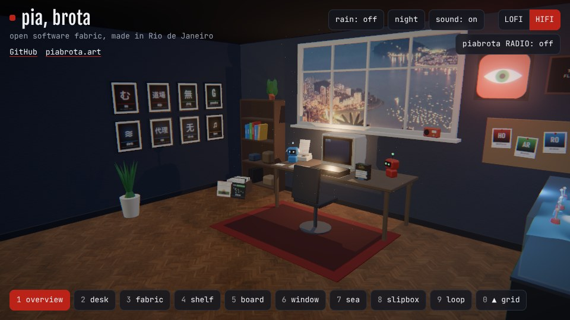
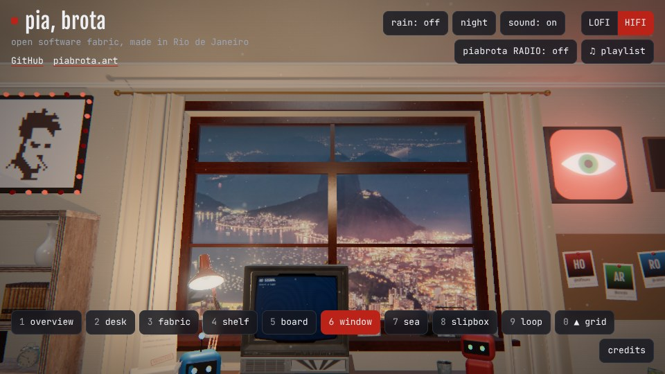
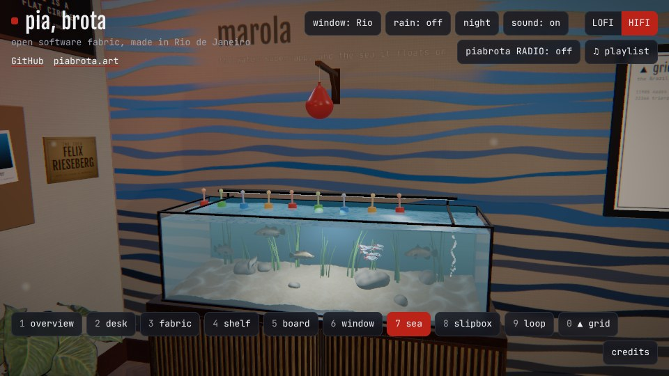

# room

[English](README.md) · Português (Brasil)

Um site pessoal que é um quarto em 3D. Troque de plano de câmera, passe o mouse sobre as coisas
para ver o que são, ponha uma fita no videocassete para vê-la na TV e escute o quarto. Feito com
[three.js](https://threejs.org) e [Vite](https://vite.dev), em arquivos estáticos.

A ideia de um quarto assim vem de **Felix Rieseberg** (`felixrieseberg` no GitHub), que fez um
como seu site pessoal. O nome e o login dele estão escritos como texto, sem link
([`AGENTS.md`](AGENTS.md), invariante 2). Este é um trabalho à parte, com seus próprios assets,
assinatura, sons e interações ([`CREDITS.md`](CREDITS.md)).



## Replay: como foi feito

O quarto foi feito a partir de prompts, num projeto do Claude, em cerca de duas horas de trabalho
de agente ao longo de um dia. Um coordenador (Claude Fable 5.1) lia cada prompt e abria uma
thread para ele; cada thread (Claude Opus 5.5, contexto de 1M, no Claude Code) fazia o trabalho e
abria o pull request. Só os prompts do dono aparecem, como foram digitados, em inglês; as
respostas ficam de fora. Os dois primeiros estão em arquivos, para ler por inteiro:

- [`prompts/PROMPT_1.txt`](prompts/PROMPT_1.txt): entender o quarto de referência, começar um esqueleto
- [`prompts/PROMPT_2.txt`](prompts/PROMPT_2.txt): o repositório e suas dez invariantes ([`AGENTS.md`](AGENTS.md))

Horários em UTC. "Levou" vai do prompt até o pull request ficar pronto para revisão.

| # | Prompt (UTC) | Resultado | Levou |
|---|---|---|---|
| 1 | 4 nov 21:20 | um esqueleto inicial, fora deste repositório | 7 min |
| 2 | 5 nov 14:35 | [#1](https://github.com/piabrota/room/pull/1) esqueleto, `AGENTS.md`, just e Nix | 7 min |
| 3 | 5 nov 16:51 | [#2](https://github.com/piabrota/room/pull/2) o botão LOFI/HIFI | 4 min |
| 4 | 5 nov 19:17 | o deploy em room.piabrota.art, em [piabrota/nix-os#146](https://github.com/piabrota/nix-os/pull/146) (no ar às 22:11) | 4 min |
| 5 | 5 nov 22:28 | [#3](https://github.com/piabrota/room/pull/3) a fita piabrota e `just compose`; [#4](https://github.com/piabrota/room/pull/4) movimentos suaves, pós-processamento | 11 e 22 min |
| 6 | 5 nov 22:51 | [#5](https://github.com/piabrota/room/pull/5) `just record`, a parede da direita e o teto | 17 min |
| 7 | 5 nov 23:21 | [#6](https://github.com/piabrota/room/pull/6) o quarto em 360°, a janela para o Rio, a piabrota RADIO | 50 min |
| 8 | 6 nov 00:33 | [#7](https://github.com/piabrota/room/pull/7) o orçamento próprio da rádio; [#12](https://github.com/piabrota/room/pull/12) 40 faixas na rádio em duas estações e a contagem de ouvintes, dia e noite, o botão da chuva, o slipbox, o quadro de letras, o favicon | 3 e 45 min |
| 9 | 6 nov 00:50 | este README | |

**1.** [`PROMPT_1.txt`](prompts/PROMPT_1.txt)

```text
user> '[the address of Felix Rieseberg's room] Check the website of this Anthropic Engineer. Is
not something professional, is his personal website. I just want to understand structure,
frameworks, and try to build one on my own, with my assets, my signature, my sounds, my
interaction'
```

**2.** [`PROMPT_2.txt`](prompts/PROMPT_2.txt)

```text
user> 'I have added piabrota/room. Create the first PR, with AGENTS.md 10 invariantes, derive
the invariants based on the first prompts (including threads). Idea must be credited to
original creator, but dont link any external repo or issue. Consider this will be tested with
macos or nix with just and Claude Code assistance'
```

**3.**

```text
user> 'merged, now add a LOFI HIFI button for switching between 3d rendered view vs plain text'
```

**4.**

```text
user> 'please create a new PR in piabrota/nix-os to deploy room site under piabrota.art/room
(KVM 4) or room.piabrota.art (KVM 4) as well'
```

**5.**

```text
user> 'Fix the room, the navigation vetween views of the room is not smooth, room design should
contain piabrota github org bot repos, names, art, inspiration. also improve tech stack to match
[the address of Felix Rieseberg's room]
https://freesound.org/people/magedu/sounds/267832/
https://freesound.org/people/klankbeeld/sounds/219877/
https://freesound.org/people/klankbeeld/sounds/174242/
https://freesound.org/people/YleArkisto/sounds/350358/

Do a sound composition to have a track to talk about piabrota, its members, my personal
projects, link to repositories. The site is very poor at moment it needs a a lot of refinement'
```

**6.**

```text
user> 'continue improving the site, every site must have at least 3 scrrenshots of the
ambient, and a screen record of 15s, doing navigation and clicking on things'
```

**7.**

```text
user> 'keep improving, more originality, bring marola-dev work, ouroboric-dev work, h0ffmann
all IP'
user> 'the room must have 360 experience, other walls should reflect marola-dev, ouroboric-dev'
```

**8.**

```text
user> 'create a live listeners button, and increase the number of musics to 33 at least, if
possible another set of specific lofi brazilian, also do the switch between lofi and hifi
views, they look opsite in the site (hifi is the 3d room). add favico the same the company
logo, check on piabrota/.github. remove the noise form the website completely (the rain sound
must be toggle, on and off). The site also lacks day and night modes (with different lights).
Records must be named slipbox and first item should be wikipedia link for pirsig, and pirsig
github repository side by side'
user> 'also add a board, on the wall with Time is a flat circle with Rust Cohle, neat the
piabrota logo above the computer'
```

**9.**

```text
user> 'refactor README.md to be more in replay style, it must have direct links for
PROMPT_1.txt and PROMPT_2.txt so people can see how it was build, using wach model, when, how
much it took. Thead responde is not important user> 'original prompt' is enought'
user> 'for example remove dois number, its just noise, this repo should be easy reforkable'
user> 'and modular, so people can user their own slangs, lists, musics'
user> 'Felix Rieseberg github user must be cited on README.md, also create a README.pt-BR.md
version'
```

O endereço do quarto de referência foi tirado dos prompts: este repositório credita Felix
Rieseberg pelo nome e não linka nenhuma página dele ([`AGENTS.md`](AGENTS.md), invariante 2).

| Visão geral | Janela | Parede do mar |
|---|---|---|
|  |  |  |

Quinze segundos navegando e clicando: [`docs/record/room.mp4`](docs/record/room.mp4).

## Rodar

Com Nix:

```sh
nix develop      # ou: direnv allow
just setup
just dev         # http://localhost:5173
```

No macOS sem Nix: `brew install node just ffmpeg`, depois as mesmas receitas `just`.
`just check` roda as verificações do [`AGENTS.md`](AGENTS.md) e um build; `just build` escreve o
site em `dist/`, pronto para qualquer hospedagem estática.

## Faça um fork, faça o seu

Faça um fork do repositório e mude [`src/config.js`](src/config.js). É o único arquivo com o que
faz deste quarto o da piabrota, e nenhum outro arquivo nomeia uma pessoa, um link ou um som.
Cada parte é um export próprio, então dá para trocar uma e manter o resto:

| Export | O que é | Para fazer o seu |
|---|---|---|
| `signature`, `place` | o nome, o slogan, os links, a cidade e seu fuso | seu nome, suas palavras, seus links |
| `theme` | as cores | sua paleta (e a fonte em `src/style.css`) |
| `shots`, `startShot` | os planos de câmera nomeados | suas vistas, ou câmeras `shot_*` do Blender |
| `ui` | as palavras dos botões | sua língua, suas gírias |
| `radio` | as estações da rádio e suas faixas | sua música, CC0 ou CC BY, cada uma com uma linha no `CREDITS.md` |
| `ambience`, `sfx` | o botão da chuva e os cliques | suas gravações (`just audio take.wav <nome>`) |
| `outside` | a vista da janela, de dia e de noite | sua cidade, duas fotos creditadas no `CREDITS.md` |
| `tapes` | o que o videocassete toca | suas fitas, um arquivo cada em `src/tapes/` |
| `projects`, `bots`, `people`, `works` | as paredes, a mesa, o quadro, a estante | suas listas |
| `sea`, `loop`, `slipbox` | as outras três paredes | suas coleções, ou tire-as |
| `hotspots` | o que pode ser clicado, e o que faz | seus rótulos, suas palavras, seus links |

Enquanto não houver modelo nem gravações, o quarto é montado com caixas e os sons são
sintetizados, então um fork roda desde o primeiro commit.

1. **Modelo.** Monte o quarto no Blender em escala real, nomeie as malhas (`screen`, `vcr`,
   `lamp`, `tape_<id>`, hotspots) e as câmeras (`shot_desk`, ...), faça o bake da luz e exporte
   `public/models/room.glb` (no máximo 10 MB).
2. **Sons.** Grave o som do ambiente e alguns cliques, depois `just audio take.wav ambience`.
3. **Fitas.** Copie `src/tapes/hello.js`; uma fita desenha no canvas da TV e pode ser um CV,
   uma apresentação, um jogo ou um instrumento.
4. **Replay.** Guarde seus próprios prompts em `prompts/`, e o quarto conta como foi feito.

O botão LOFI/HIFI no canto alterna entre o quarto em 3D (HIFI) e o mesmo conteúdo em texto puro
(LOFI). `?lofi` no endereço abre a vista em texto; sem WebGL, LOFI é a única vista.

## Licença

[MPL-2.0](LICENSE). Os assets em `public/` são do dono, salvo o que o `CREDITS.md` disser.
