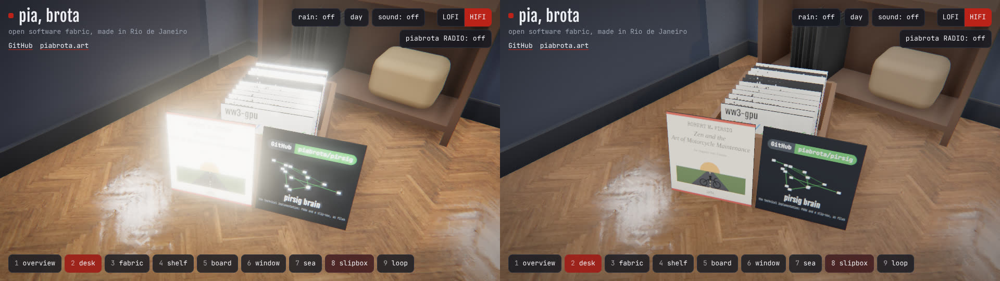
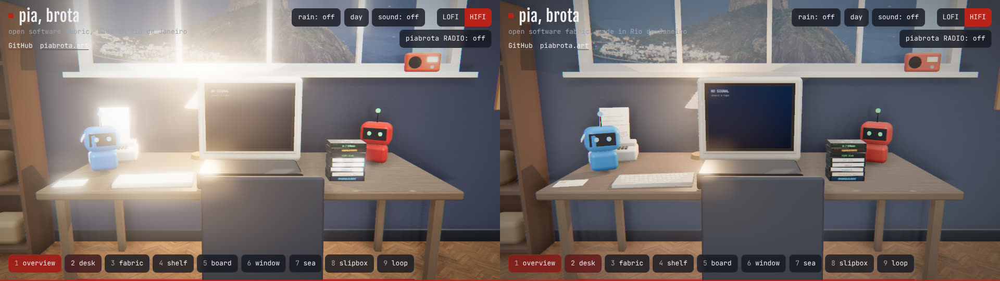
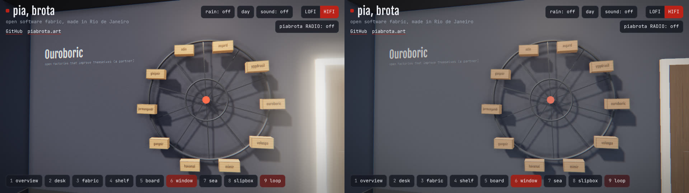
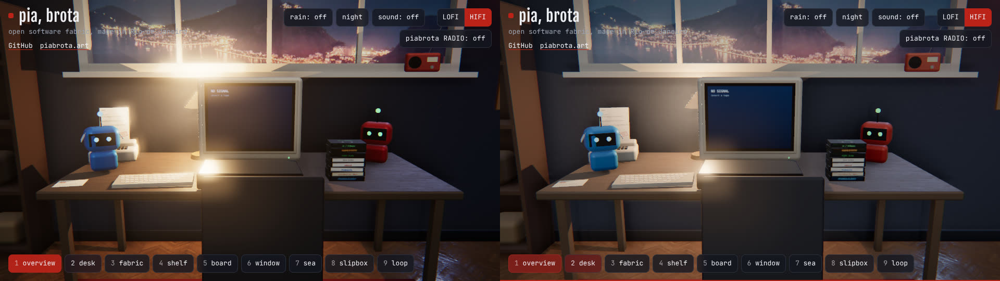

# Survey: a more real room, a faster loop, and a tenth view

Written on 6 November 2026 against `main` at `ac2662e` (after #15), for the owner's prompt 12 in
the [replay](../README.md#replay-how-it-was-built). It answers seven questions. Each section ends
with what to do, in the order it pays off. Nothing here changes the site; the measurements were
made on a local build with two lines patched in and then reverted.

| # | Question | Short answer |
|---|---|---|
| 1 | Other open rooms, ideas to borrow | four MIT rooms worth reading; borrow baked light, a "neutral light" switch, an in-room computer UI, a focus-zoom on click |
| 2 | Other frameworks | stay on three.js and Vite; move to `WebGPURenderer` and TSL when the room needs compute; React/Svelte wrappers add little to a config-driven site |
| 3 | Animation tools | `camera-controls` for the rig, GSAP or anime.js for the UI, Theatre.js only for authored sequences |
| 4 | Own shaders and textures | bake in Blender, author materials in TSL or `onBeforeCompile`, ship KTX2 |
| 5 | A faster loop | `just record` renders with SwiftShader everywhere, also on a Mac; 2.5 s a frame at 720p. Use the GPU, 960×540, no AO while recording: about 10× faster |
| 6 | The tenth view, "▲ grid" | a lazy MapLibre view with the mesh drawn by a custom WebGL layer; WW3 on a 15k-node triangle mesh, forced by GFS, 24 h, runs in minutes |
| 7 | Day blows out to white | the bloom threshold (0.92) sits below the brightness of a lit wall by day; fix it per mode and switch to AgX |

### Applied in #16

The second commit of #16 applied what can land without the owner changing an invariant:

- **7, the white-out:** bloom has a night and a day threshold (0.92 and 3, strength 0.55 and
  0.35; `post.setDay`), tone mapping is AgX at exposure 1.1 day and night, and the desk lamp gives
  35 % of its light by day (the lamp button keeps it; from the "Refine room navigation" thread).
  `just light` now measures every shot: none burns a pixel to white, by night or by day.
- **5, the loop:** `just record` uses the GPU on macOS, and in software records at 960×540 with
  ambient occlusion off (`?record`); `just stills` makes the stills alone.
- **3 and 4, realism:** CRT glass over the TV (`src/tv.js`, `onBeforeCompile`) and dust drifting
  in the window's light (`src/room.js`, one draw call, still under reduced motion).
- **Skills:** `.claude/skills/` has `room-pr`, `room-light`, `room-content`, `room-shaders` and
  `ww3-grid`, so a Claude working here (or on a fork) starts from these rules and plans.

### Applied in #18

- **6, the tenth view:** invariant 4 now gives a tenth shot key `0` (its own commit, first). "▲ grid"
  is a chart on the right wall; its shot opens a MapLibre map over the room
  (`src/grid.js`): the coast's triangle mesh, 11 905 nodes and 22 366 triangles from Natural
  Earth's coastline (`just grid`), coloured by the sea of each hour, with the triangles' edges and
  the wind on top, 24 h played by the room's clock, a node's numbers on hover. Land and data ship
  in `public/grid/` (1.2 MB); nothing is hotlinked, and the map has no text layer, so it needs no
  fonts. The wind is NOAA's GFS 0.25° at 10 m, through Open-Meteo's API (CC BY 4.0). **The sea is
  estimated from that wind** (Pierson–Moskowitz, a fully developed sea), and the view says so:
  WAVEWATCH III itself is not run yet (below).
- **3, life:** the TV's light follows the brightness of the tape's picture, the rain button
  puts drops on the glass that cling and run, and the plants' leaves sway (vertex shaders, driven
  by the room's clock, still under reduced motion).
- **2, Vite 6** (6.4.5): the build, the preview and the dev server run as before.

### Applied in #19

- **6, the sea's temperature:** `just grid` reads the latest day of OSTIA (the Met Office's daily
  foundation SST at 0.05°, Copernicus Marine, doi:10.48670/moi-00165) from the service's public
  ARCO zarr store, with no account: two chunks of 1024 × 1024 cells cover the domain, decoded by
  `scripts/blosc.mjs` (Blosc and LZ4, written here, no native module), sampled at the nodes into
  `public/grid/sst.bin` (23 kB). The view switches between the sea's height and its temperature.
- **6, the flow:** the wind's ticks are gone. Particles are carried where the waves travel, each
  leaving a trail that fades, as on the wind maps: towards the wind, at the group speed of a fully
  developed sea (cg = gT/4π, about 0.57 U). They break on the coast, step at 1/30 s of the room's
  clock from a seeded generator (so `just record` films the same flow), keep their speed on the
  screen at any zoom, and stand still under reduced motion.

Still left, and why:

- **WAVEWATCH III on the mesh.** It needs a Fortran toolchain (gfortran, NetCDF-Fortran, MPI) and
  a Nix devShell to build WW3 v7; neither is in this repository yet, and the cloud session that
  made #18 had none. The mesh and the export format are ready for it (`.claude/skills/ww3-grid`):
  write `mesh.bin` as Gmsh `.msh`, run `ww3_grid`, `ww3_prnc` with the same GFS hours,
  `ww3_shel`, `ww3_ounf`, and write `frames.bin` from its Hs.
- **Bathymetry** on the mesh (GEBCO): not needed until WW3 runs.
- **A Blender bake and KTX2:** they need the owner's Blender model (`room.glb`); the placeholder
  room is built in code.
- **`WebGPURenderer` and TSL:** a rewrite of the post chain, worth it when something needs compute.
- **`camera-controls`:** the hand-written rig already eases, keeps velocity and is deterministic
  for `just record`; replacing it would lose that for little.

---

## 1. Other open rooms

The idea of this room is Felix Rieseberg's ([`CREDITS.md`](../CREDITS.md)); this section looks at
other people's rooms. Licences were read from GitHub on 6 November 2026. Reading code to learn is
fine; copying needs the licence and a row in `CREDITS.md` (invariant 1). A repository with no
licence is all rights reserved: look, do not copy.

| Room | Licence | Stack | Worth borrowing |
|---|---|---|---|
| [brunosimon/folio-2019](https://github.com/brunosimon/folio-2019) | MIT | three.js, Cannon physics | physics on small props (a tape that tips over when clicked), the sound of each surface |
| [brunosimon/folio-2025](https://github.com/brunosimon/folio-2025) | MIT | three.js WebGPU, TSL | a recent room-scale site on three.js's `WebGPURenderer` and TSL: read it before our own move to WebGPU |
| [brunosimon/my-room-in-3d](https://github.com/brunosimon/my-room-in-3d) | none (look only) | three.js, Blender bake | the method: everything baked in Blender, a day, a night and a neutral bake mixed in one shader, with light maps for the lamps and screens added on top. The source has no licence, so only the idea is used |
| [henryjeff/portfolio-website](https://github.com/henryjeff/portfolio-website) | MIT | three.js, Blender | a real UI inside the computer screen (an iframe drawn with CSS3DRenderer over the monitor), the camera that eases to the screen on click |
| [iivvaannxx/my-room](https://github.com/iivvaannxx/my-room) | MIT | TypeScript, three.js, camera-controls, Tweakpane | a realtime clock, a "neutral lighting" switch, smooth focus with `camera-controls` |
| [andrewwoan/sooahs-room-folio](https://github.com/andrewwoan/sooahs-room-folio) | MIT | three.js, Blender, GSAP | hover and intro animations with GSAP, a strong colour palette |

Ideas that fit our invariants:

- **Bake the light** (invariant 9 already asks for it). The placeholder room has none: every
  surface is lit at run time by five lights and an environment. A Blender bake of the room into
  two or three 2048² atlases, mixed in the shader between a night and a day bake, is the largest
  single step toward realism, and it removes the day/night light sets of `src/room.js`.
- **A focus zoom on the screen.** Click the TV and the camera eases to fill the frame with it; the
  tape becomes legible. This is one more shot in `config.shots` (invariant 4).
- **The computer as a page.** A CSS3DRenderer layer over the beige computer could show LOFI's
  text inside the room. Keep it a shot, not free navigation.
- **Hover with a spring.** Today the hover is an outline and a glow (invariant 5). A 3 % scale
  spring and a lift of 5 mm make it feel touched. Respect `prefers-reduced-motion`.

## 2. Other frameworks

| Option | What it would give | Cost here | Verdict |
|---|---|---|---|
| three.js r170 → current, `WebGLRenderer` | what we have | none | keep |
| three.js `WebGPURenderer` + TSL | compute shaders (the wave field, particles of rain on the glass), one shader language for WebGPU and WebGL 2 fallback | post chain to rewrite in TSL nodes (`pass`, `bloom`, `ao`); `EffectComposer` does not run on it | the next big step, when the grid view needs compute |
| [react-three-fiber](https://github.com/pmndrs/react-three-fiber) + drei (MIT) | components, a large helper set (`<Bvh>`, `<Bake>`, `<Environment>`, `<ContactShadows>`) | React and a rewrite; the room is config driven, not component driven | no |
| [Threlte](https://github.com/threlte/threlte) (Svelte, MIT), [TresJS](https://github.com/Tresjs/tres) (Vue, MIT) | the same idea for Svelte or Vue | a rewrite | no |
| [Babylon.js](https://github.com/BabylonJS/Babylon.js) (Apache-2.0) | a full engine: inspector, node material editor, WebGPU first | a rewrite; heavier bundle | no |
| [PlayCanvas engine](https://github.com/playcanvas/engine) (MIT) | lightmapper in the engine, Gaussian splats | a rewrite | no; but its splats are worth a look for the view out of the window |
| Vite 5 → Vite 6/7 | faster cold start, Rolldown later | a version bump | yes, in its own pull request |

The room is a small static site whose shape is set by `src/config.js`; a component framework
solves a problem it does not have. The two real moves are keeping three.js current and, later,
`WebGPURenderer` with TSL. Pull libraries in one at a time, each with its licence noted.

## 3. Animation

What moves today: the camera rig (`src/cameras.js`, quintic curves written by hand), the tape
tween (`src/app.js`), and a few `animated` callbacks. The hand-written curves are good and
deterministic, which `just record` needs. Candidates:

| Library | Licence | Use here |
|---|---|---|
| [camera-controls](https://github.com/yomotsu/camera-controls) | MIT | could replace the drag-to-look and the shot moves: damped `setLookAt` transitions, `fitToBox` for a focus zoom. Keep the shots and `Esc` (invariant 4); disable dolly and truck so there is still no free orbit |
| [GSAP](https://gsap.com/) | free for all use since Webflow's acquisition (April 2025), under GSAP's own standard licence, not an open-source one | timelines for the UI: the enter gate, the radio panel, the tape label sliding out. All plugins are now free |
| [anime.js](https://github.com/juliangarnier/anime) v4 | MIT | the same, with an OSI licence and a smaller bundle; prefer it if the licence matters |
| [Theatre.js](https://github.com/theatre-js/theatre) | Apache-2.0 (core) | an editor to author a sequence (an intro fly-in, the fax printing) and play it back from a JSON file. Only worth it for authored sequences |
| [Rive](https://github.com/rive-app/rive-wasm) runtime | MIT runtime | 2D animated textures: a tape label, the fax screen, the radio dial, drawn to a canvas texture |

Things that make the room feel alive without a library: dust motes in the window's light (one
`Points` with 300 particles in a box, drifting with a noise), the plant's leaves swaying with a
vertex shader, the curtain of rain on the glass by day, the TV's light flickering with the tape's
brightness (read back the TV canvas's average once a frame), and a breathing idle on the camera
(already there as parallax). Each must stop under `prefers-reduced-motion` (invariant 8), and be
driven by `elapsed` so `just record` stays deterministic.

## 4. Our own shaders, textures and materials

1. **Bake in Blender.** Cycles bake, Combined pass, into the base colour, with UVs packed into two
   or three atlases; `room.js` already turns baked meshes into `MeshBasicMaterial`
   (`useBakedLighting`) and keeps `*_live` lit. Bake twice (night: lamp, neon, moon; day: sun,
   sky) and mix the two textures with a `uDay` uniform: day/night becomes a fade, not a switch.
2. **Extend three's materials, do not replace them.** `material.onBeforeCompile` (no
   dependency) or [THREE-CustomShaderMaterial](https://github.com/FarazzShaikh/THREE-CustomShaderMaterial)
   (MIT) keeps lighting and shadows and adds a few lines: a rain-streak normal on the window
   glass, a CRT mask and scanlines on the TV, wear on the desk's edges from a curvature mask.
   With `WebGPURenderer`, the same is written in TSL; [boytchev/tsl-textures](https://github.com/boytchev/tsl-textures)
   (MIT) has procedural wood, marble and noise to start from.
3. **Textures we make.** Photograph our own surfaces (the owner's desk, a real VHS label, Rio's
   wall plaster) flat, in shade, with a grey card, and make PBR sets from them in
   [Material Maker](https://github.com/RodZill4/material-maker) (MIT). Each new file gets a row in
   `CREDITS.md` naming the owner. Poly Haven and ambientCG (CC0) stay the fallback.
4. **Ship them small.** Compress to KTX2 (Basis Universal) with
   [glTF-Transform](https://github.com/donmccurdy/glTF-Transform) (MIT):
   `gltf-transform etc1s` for colour, `uastc` for normals. GPU memory drops about 4×, and the
   25 MB budget of `public/` holds a baked room. Add it as a `just` recipe.
5. **Light that reads as real.** A `RectAreaLight` the size of the window (with
   `RectAreaLightUniformsLib`) instead of a point-like sun gives the soft, wide light a real window
   gives. A screen-space ambient occlusion with better contact ([n8ao](https://github.com/N8python/n8ao),
   CC0) or screen-space GI ([realism-effects](https://github.com/0beqz/realism-effects), MIT) are
   options, but a bake makes both unnecessary.
6. **Path-traced stills.** [three-gpu-pathtracer](https://github.com/gkjohnson/three-gpu-pathtracer)
   (MIT) renders the same scene as ground truth: use it to tune the real-time light against, and
   for README stills.

## 5. A faster loop for `just record`

Measured in this session on 4 cores, no GPU, SwiftShader, 1280×720, the desk shot, 20 frames:

| Setting | ms a frame | of which: render | of which: screenshot |
|---|---|---|---|
| as today | 2 540 | 1 710 | the rest |
| ambient occlusion off | 1 760 | 1 120 | the rest |
| 854×480 | 1 160 | | |

`window.__room.step()` returns in about 12 ms: the GPU work happens when the screenshot asks for
the frame. #15's video is 35 s, 1 050 frames, so 1 050 × 2.5 s ≈ 44 min here; the 15 s that
`AGENTS.md` asks for is about 19 min.

What to change, biggest first:

1. **Use the GPU when there is one.** `scripts/record.mjs` always passes
   `--use-angle=swiftshader`, even on a Mac with Google Chrome. On macOS, launch with
   `--use-angle=metal` (or no `--use-angle` at all) and keep SwiftShader only when
   `process.platform === 'linux'` and no GPU is found. On a laptop GPU a frame renders in about
   10 ms; the screenshot becomes the cost, and the video takes about a minute.
2. **Record what the PR needs: 15 s, not 35 s.** The script now records about 35 s of
   navigation. Cut it to the 15 s the rule asks for, or make the length a flag (`--seconds 15`).
3. **A recording quality.** Add `?record` that turns the ambient occlusion off and caps the
   pixel ratio at 1 (the adaptive quality already knows how). With 960×540 and no AO, a frame is
   about 0.8 s: 15 s of video in about 6 min on SwiftShader.
4. **Stills while working, video at the end.** `just record --stills` exists; make it a recipe
   (`just stills`) and use it during a change. Record the video once, just before the pull request.
5. **Do not record what did not change.** Hash `src/`, `public/` and `scripts/record.mjs` into
   `docs/record/.hash`; skip the video when the hash is the same.
6. **Fewer round trips.** One `page.evaluate` that steps and returns the frame
   (`canvas.toDataURL` with `preserveDrawingBuffer` during recording, or WebCodecs' `VideoEncoder`
   in the page) avoids the screenshot. The DOM overlay (buttons, cursor, label cards) then has to
   be drawn into the frame; that is the cost of this step, so do it last, if at all.
7. **A GPU in CI, later.** GitHub's larger runners include GPU machines (paid); a self-hosted
   runner on the nix-os host with a GPU also works. Both need the flags of step 1.

## 6. The tenth view: "▲ grid"

### Who had the idea

Triangular (unstructured) grids for WAVEWATCH III were introduced by **Dr. Aron Roland**
(Darmstadt; BGS IT&E, now BGS Wasser), with Fabrice Ardhuin (Ifremer): Roland's WWM work and its
port into WW3. The regression test of WW3's triangle grid, `ww3_tp2.6` (Limón harbour, Costa
Rica), names "Aron Roland and Fabrice Ardhuin" as its authors (January 2011), last changed by Ali
Abdolali in October 2018. At NOAA, **Dr. Ali Abdolali** (NWS/NCEP Environmental Modeling Center)
led the domain decomposition and the implicit scheme on unstructured grids, with Roland,
in the work applied to Hurricane Dorian (Smith, Hesser, Abdolali, Bryant, Roland and Cox, ICCE).
Dr. Roland is not a NOAA employee; "Dr. Aaron from NOAA" in the prompt means Aron Roland, who
worked with NOAA on this (confirmed by the owner, 6 November 2026).

Sources: [`ww3_tp2.6/info`](https://www.nco.ncep.noaa.gov/pmb/codes/nwprod/hafs.v2.0.8/sorc/hafs_ww3.fd/regtests/ww3_tp2.6/info),
[Advances in the unstructured WAVEWATCH III and application to Hurricane Dorian](https://icce-ojs-tamu.tdl.org/icce/article/download/10249/9535/36502),
[EGU25-16980](https://meetingorganizer.copernicus.org/EGU25/EGU25-16980.html),
[Roland and Ardhuin, Ocean Dynamics 2014](https://data-ww3.ifremer.fr/BIB/Roland_Ardhuin_OD2014.pdf).

The owner's own work on WW3 is ww3-gpu. His six works with a DOI, cited together: marola
[10.5281/zenodo.23224155](https://doi.org/10.5281/zenodo.23224155), ww3-gpu
[10.5281/zenodo.23221351](https://doi.org/10.5281/zenodo.23221351), picasso
[10.5281/zenodo.23311208](https://doi.org/10.5281/zenodo.23311208), closed source
[10.5281/zenodo.23333656](https://doi.org/10.5281/zenodo.23333656), marola-bench
[10.5281/zenodo.23352633](https://doi.org/10.5281/zenodo.23352633), nashkell, the open book
[10.5281/zenodo.23356739](https://doi.org/10.5281/zenodo.23356739).

### Two invariants to change first

- **Invariant 4** gives shots the keys 1 to 9, and there are nine shots. A tenth needs `0` as
  its key. That is a change to `AGENTS.md`, in its own pull request, approved by the owner.
- **Invariant 1** says nothing is hotlinked. A MapLibre basemap from a tile server would be. Ship
  the basemap: Natural Earth's coastline and land (public domain), clipped to Brazil and
  simplified (a few hundred kB of GeoJSON), or an OpenStreetMap extract as a single
  [PMTiles](https://github.com/protomaps/PMTiles) file in `public/` (ODbL, credited in
  `CREDITS.md`), at zoom 0 to 8 only, to stay inside the 25 MB.

### How it looks and works

- `config.shots.grid` is a camera that eases to a framed chart on the wall (or the beige
  computer), and `config.grid` holds the mesh, the run and the words. Nothing about the grid is
  hardcoded outside config (invariant 3).
- When the camera lands, a full-screen MapLibre map fades in over the canvas, framed on the same
  place; `Esc` or any other shot fades it out and returns to the room (invariant 4). The map
  code is a dynamic `import()`, so MapLibre (about 800 kB, 230 kB gzipped) loads only the first time.
- The mesh is drawn by a **MapLibre custom layer** (`CustomLayerInterface`, raw WebGL, no other
  dependency): one vertex buffer of node positions in Mercator, one index buffer of triangles,
  one `Float32` texture of significant wave height, nodes × time steps. A uniform `t` picks and
  blends two time steps on the GPU, so playing is free. The edges are drawn as lines on top, thin
  and white, so the triangles are visible: the view is about the grid. `deck.gl`'s
  `MapboxOverlay` is the alternative if we want picking and tooltips without writing them.
- Controls: play and pause, a time slider with the forecast hour, the variable (Hs, peak period,
  direction as short arrows at nodes). Hover a node: its depth, Hs and Tp (invariant 5).
- LOFI shows the run's date and a still PNG of the mesh.

### Running WW3 on a small triangle mesh, forced by GFS

Keep it small so a run takes minutes and the dev loop stays short:

| Choice | Dev value | Why |
|---|---|---|
| Domain | the Brazilian coast, 35°S to 5°N, out to about 500 km | the shelf and the coast are where triangles pay off |
| Mesh | about 15 000 nodes, 50 km offshore to 3 km at the coast | made with [OCSMesh](https://github.com/noaa-ocs-modeling/OCSMesh) (CC0) or [oceanmesh](https://github.com/CHLNDDEV/oceanmesh) (GPL, a tool, its output is ours), saved as Gmsh `.msh` v2 |
| Bathymetry | GEBCO 2024, 15 arc seconds, averaged to the nodes | free with attribution |
| Spectrum | 24 frequencies × 24 directions (production: 36 × 36) | about 2× faster |
| Physics | ST4, the default propagation for triangles (explicit N scheme, `EXPFSN`) | stable on a coarse mesh; `IMPTOTAL` with PDLIB when the mesh gets fine |
| Time step | global 600 s | the explicit scheme limits it at the smallest triangle |
| Horizon | 24 h, output every hour | 25 frames to play |
| Forcing | GFS 0.25°, `UGRD` and `VGRD` at 10 m, 3-hourly, from NOMADS' grib filter (`filter_gfs_0p25.pl`) over the domain box, or the same files on AWS Open Data | US government data, public domain |
| Open boundary | none at first (wind sea only); later, spectra from NOAA's global GFS-Wave | swell from the south arrives later in the forecast |

The steps, as `just` recipes in a `ww3/` folder of this repository (or its own repository, so
the site does not carry Fortran):

1. `just ww3-build`: WW3 v7 with CMake, `gfortran`, NetCDF-Fortran, MPI, in a Nix shell
   (`flake.nix` devShell `ww3`). Use the switches of `regtests/ww3_tp2.6` for the triangle grid
   and add `NC4` and `ST4`; check that test's `info` in the version you build, the switches have
   changed between releases.
2. `just ww3-mesh`: the mesh, once, into `ww3/grid/brasil.msh`, with the boundary nodes listed;
   `ww3_grid` reads it with the grid type `'UNST'` and writes `mod_def.ww3`.
3. `just ww3-winds <cycle>`: fetch GFS for the cycle (for example `20261106 00Z`, hours 0 to 24
   every 3 h), turn GRIB2 into NetCDF with `wgrib2 -netcdf` or `cdo -f nc copy`, and run
   `ww3_prnc` to make `wind.ww3`.
4. `just ww3-run`: `ww3_shel` (one process or `mpirun -n 4`), then `ww3_ounf` for `HS`, `T02`,
   `DIR` on the nodes into NetCDF.
5. `just ww3-export`: a Python or Node script reads the NetCDF and the `.msh` and writes what the
   site loads: `public/grid/mesh.bin` (nodes as `Float32` lon/lat, triangles as `Uint32`),
   `public/grid/hs.bin` (`Uint8`, Hs quantized to 0 to 12.75 m in 5 cm steps, nodes × 25 frames,
   about 375 kB), and `public/grid/run.json` (the cycle, the times, the scales). Gzip on the
   server halves it. The budget of invariant 9 holds.

Cache the mesh and `mod_def.ww3`; only the winds and the run change per cycle. A daily run on the
nix-os host could refresh `public/grid/`, but that is a deploy question for later; the first
version plays a fixed run.

### Order of work

1. The invariant change for key `0` and the basemap rule (owner).
2. The view with a fixed, tiny made-up mesh and fake Hs, so the map, the layer, play and `Esc`
   work and `just record` can show it.
3. The real mesh and one WW3 run, exported.
4. Hover, the variables, LOFI.

## 7. Why the day blows out to white

### What happens

The room renders into a half-float buffer and the chain is: render → ambient occlusion → outline
→ **bloom (`UnrealBloomPass`, strength 0.55, radius 0.5, threshold 0.92)** → `OutputPass` (tone
mapping and sRGB) → grade (`src/post.js`). Bloom runs on the linear, scene-referred light, before
tone mapping. A threshold of 0.92 was set for the night, when only emissive things (the bulb, the
sign, the TV, the bots' eyes) pass 1.0. By day (`src/room.js`, `DAY`) the hemisphere light is
3.4, the sun 5 and the environment 0.55: a white card, the door frame, the window frame, the
fax's paper and the socks all reach well above 1.0. Everything bright blooms, the halos add up,
and with ACES at an exposure of 1.3 (three's ACES divides exposure by 0.6, so the effective gain
is about 2.2) the frame fills with white haze.

Two smaller causes:

- `toneMapped: false` on the bulb, the LEDs, the sign and the window's photographs does nothing in
  this chain: three only tone-maps when it draws to the screen, and here `OutputPass` tone-maps
  the whole buffer. The day photograph is therefore pushed by the same gain and looks washed.
- ACES desaturates and clips bright colours to white fast; AgX rolls them off more gently.

### Measured

Headless Chrome (SwiftShader), 960×540, `?day`. Mean is the mean luminance of the frame (0 to
255); clipped is the share of pixels above 245.

| Shot | as today | bloom threshold 4 | exposure 1.0 | AgX, exposure 1.0 | lights lowered (hemi 1.2, sun 3, env 0.3) | **recommended** |
|---|---|---|---|---|---|---|
| desk | 127 / 2.8 % | 95 / 0.7 % | 114 / 2.0 % | 115 / 0 % | 92 / 1.3 % | **96 / 0 %** |
| slipbox | 122 / 3.4 % | 97 / 0 % | 109 / 2.2 % | 111 / 0 % | 66 / 0 % | **95 / 0 %** |
| window | 127 / 2.1 % | 94 / 0.4 % | 115 / 1.2 % | 115 / 0 % | 90 / 0.6 % | **94 / 0 %** |
| loop | 92 / 0 % | 79 / 0 % | 79 / 0 % | 90 / 0 % | 54 / 0 % | **84 / 0 %** |

"Recommended" is bloom threshold 3, AgX, exposure 1.1, the day lights unchanged. The threshold
alone removes most of the haze; AgX removes the last clipped pixels. Left as today, right
recommended:

But a threshold of 3 also kills the night's glow, since the bulb is only about 1.0 bright
(left as today, right with the recommended settings applied at night):

### The fix

1. **Make emissive things brighter than lit things, and bloom only them.** Give the bulb, the
   sign's face, the LEDs, the eyes, the TV and the radio dial an HDR value (for example
   `color.setRGB(…).multiplyScalar(4)`, or `emissiveIntensity` 4 to 8) and set the bloom threshold
   to about 2.5 for day and night alike. Then a lit white wall never blooms and the bulb always
   does. If that is too much tuning, the minimum fix is a threshold per mode in `setDay`:
   `bloom.threshold = on ? 3 : 0.92` (the post chain needs to return `bloom` for that).
2. **AgX tone mapping** (`THREE.AgXToneMapping`, in r170) and exposure 1.1 by day, 1.0 by night,
   set in one place. `NeutralToneMapping` is the other option if AgX looks too grey.
3. **The window's photographs**: since they are tone-mapped anyway, lower their colour to about
   0.75 by day, or draw the outside in its own pass after `OutputPass`.
4. Then, and only then, retune the day lights by eye. They are fine once bloom and tone mapping
   are right (the "lights lowered" column shows that lowering them alone makes the room dim
   without removing the halos).

The thread "Refine room navigation, design and tech stack" is fixing this in code; this section
is the analysis behind it.

## 8. Why the room looked poor beside the room that gave the idea (10 November 2026)

The owner, on 10 November 2026: "our quality compared to theirs is sub poor. For example his VHS
tapes have way more quality", and "this must look a old fashioned apartament". Felix Rieseberg's
room was opened again in a headless browser that day and compared with ours, view by view. Nothing
of it was taken: no model, texture, sound, word or line of code (invariant 1), and this file does
not link it (invariant 2). What was learnt is where its quality comes from.

### The gaps

| # | His room | Ours, before | What was done |
|---|---|---|---|
| 1 | Furniture and props are photographed models with colour, normal and roughness maps; his own credits thank Poly Haven for them | Boxes and cylinders in flat colours | Twenty-three models from Poly Haven (CC0), packed by `just models`: a television, a clamp lamp, a radio cassette player, an armchair, a bookcase, a sideboard, a sofa, a long-case clock, a chandelier, plants, books, a painting, a suitcase, a ukulele |
| 2 | Light is baked: every surface has soft bounce and contact shade | Six real-time lights on flat dark walls, no bounce | Light walls that carry the lamps' light, a hanging lamp, a soft shadow drawn under each piece (`contactShadows`), ambient occlusion on the laptop's look. Baking stays future work: it needs the room in Blender |
| 3 | The hero view is at the desk's height, close, with things overlapping in depth | A wide view of large flat surfaces; the desk seen from 1.9 m | The desk's shot is 1.5 m from the TV, at 1.36 m, with the chair, the lamp and the window in depth |
| 4 | Tapes in card sleeves with printed spines, in two piles that are not aligned, a loose cassette on top | Eight identical black boxes, 10 % too large, a 512 × 72 label each | `src/vhs.js`: a cassette at 187 × 103 × 25 mm with windows, reels and flap; card sleeves, each its own design from config; two piles; the cassette leaves its sleeve and goes in by the slot |
| 5 | A tall wooden window with its reveal, and curtains | A hole in a plane, its sill 1.5 m up | A window of 2.40 × 1.75 with its sill at 1.00, set 16 cm into the wall, two leaves and a fanlight in rosewood, a sill board, curtains to the floor on a brass rod |
| 6 | The desk is full of small things | A keyboard and two robots | A cup of pencils, pens, an aloe, a box under the desk; the bookcase holds an encyclopaedia, a vase and a clock |
| 7 | Materials vary: grain, wear, a different shine for wood, cloth, metal, plastic | One roughness (0.75) and a colour | Photographed rosewood and walnut laid in metres along the grain, plaster with its own grain and uneven paint, cotton, brass |
| 8 | The television and the recorder are modelled | Rounded boxes with a canvas front | A photographed television with the picture laid on its bulged glass; a recorder at 430 × 90 × 300 mm with a slot, a flap, keys, a clock |
| 9 | Proportions are those of a real room | A desk of 2.30 × 0.95, a recorder 0.58 wide, a chair of two slabs, a skirting of 10 cm | Every piece at its real size (`src/shell.js` and `src/room.js` say the numbers) |
| 10 | A "credits" control on screen | None | A credits button and card, and a brass plate in the room (`src/creditscard.js`, `src/credits.js`) |

### What an old apartment in Rio has

High ceilings (3.10 m here) with a cornice and a rose where the lamp hangs; plaster walls painted
a warm white many times; a tall skirting and door and window frames in dark wood; a floor of
small hardwood blocks in herringbone ("taco"); a tall window of two leaves with a fanlight, deep
in a thick wall; curtains to the floor; a rug; furniture of several decades living together.
`src/shell.js` builds these, and `config.shell` holds the colours.

### What it costs

The models are 7.1 MB for the laptop's look and 2.1 MB for the phone's, which also leaves the
small props out (`phone: false` in `config.models`). The laptop's look waits for them, six
seconds at most; the phone's opens at once with plain stand-ins and each piece takes its place
as it arrives. A model that is missing leaves its stand-in (invariant 8). The pull request
gives the numbers of `just peek` and `just mobile` before and after.
